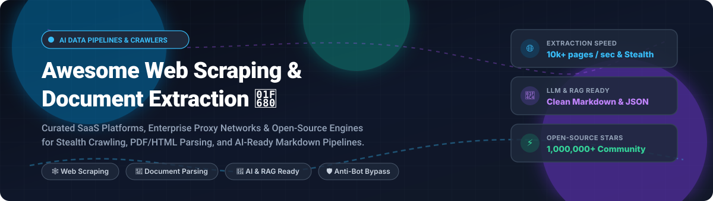

 
 

# 🌐 Awesome Web Scraping & Document Extraction 📑⚡

**A definitive, SEO-optimized curated directory of enterprise SaaS platforms, stealth proxy infrastructure, and high-performance open-source GitHub engines for automated web scraping, anti-bot bypassing, headless browser orchestration, and multimodal document extraction.**

*Optimized for LLMs, RAG Pipelines, AI Agents, Data Engineering, and High-Throughput Web Crawling.*

**Last updated:** November 2026

---

## 📌 Table of Contents

- [📊 Sector Overview & Market Dynamics](#-sector-overview--market-dynamics)
- [🏢 SaaS & Hosted Platforms](#-saas--hosted-platforms)
- [💻 Open-Source GitHub Projects](#-open-source-github-projects)
- [🛠️ Additional Strong Open-Source Engines](#️-additional-strong-open-source-engines)
- [🌟 Star History](#-star-history)
- [🤝 How to Contribute](#-how-to-contribute)
- [☕ Support](#-support)
- [⚖️ Disclaimer](#️-disclaimer)

---

## 📊 Sector Overview & Market Dynamics

The global web data extraction and web scraping software market is currently estimated at approximately **$1.6B – $1.8B** and is projected to expand rapidly past **$4.0B – $9.0B by 2030** (growing at a compound annual growth rate of 13%–18%, with AI-driven web scraping surging at nearly 28%+ CAGR driven by generative AI training data and real-time RAG workloads). 

The sector displays a **moderately fragmented yet tiered oligopolistic structure**: enterprise IP proxy infrastructure and stealth anti-bot unlocking networks are concentrated among a few scaled category leaders (such as Oxylabs and Bright Data commanding $300M+ ARR brackets), while developer-first APIs, headless browser cloud runtimes, AI web extraction agents, and unstructured document ingestion tools remain highly competitive and fragmented with rapid open-source innovation.

---

## 🏢 SaaS & Hosted Platforms

A comprehensive comparison of top web scraping, stealth proxy rotation, anti-bot bypass, and cloud browser rendering platforms. Tiers and free limits are verified and sorted in descending order of company size (Valuation / ARR).

| Company / Product 🚀 | Market Size / Valuation / ARR 💰 | Pricing (Starting Tier) 💳 | Free Tier / Trial Limit 🎁 | Description 📝 |
| :--- | :--- | :--- | :--- | :--- |
| **[Oxylabs](https://oxylabs.io)** | **$3.6B Valuation** (~$350M ARR) | **$30.00 / month** (Starter plan at ~$6/GB) or $49/mo Scraper API | **One-time $5 free credit** upon dashboard sign-up & KYC verification; 7-day trials available for enterprise testing | Enterprise residential proxy network (100M+ IPs), AI-powered web scraper APIs, and Web Unblocker for e-commerce, SERP, and structured data. |
| **[Bright Data](https://brightdata.com)** | **$1.0B+ Valuation** (~$300M ARR) | **Pay-as-you-go ($5.00 / GB residential)** or $499/mo Growth plan | **5,000 free API credits / month recurring** ($7.50 value; no credit card required) + small $2–$5 proxy trial credit | Global web data platform providing enterprise proxy infrastructure, Scraping Browser with built-in CAPTCHA solving, and ready-to-use dataset APIs. |
| **[Zyte](https://zyte.com)** | **~$25M ARR** (Funded ~$3M) | **Pay-as-you-go ($0.13 / 1,000 HTTP requests)** or $9/mo Scrapy Cloud unit | **$5 free trial credit** valid for 30 days; 1 free low-resource Scrapy Cloud unit (7-day data retention) | AI-powered web scraping platform created by the authors of Scrapy, featuring ban-free proxy management, automated extraction APIs, and managed crawls. |
| **[Apify](https://apify.com)** | **~$12M–$13M ARR** ($3.5M Funding) | **$19.00 / month** (Starter Tier) | **$5.00 free usage credit every month recurring** (no credit card required; up to 16 GB RAM per run, 5 datacenter proxy IPs) | Serverless cloud platform for web scraping, data extraction, and browser automation powered by thousands of turnkey open-source Actors. |
| **[ScraperAPI](https://scraperapi.com)** | **~$10M+ ARR** (Acquired by SaaS.group) | **$49.00 / month** (Hobby Tier for 100,000 API credits) | **1,000 free API credits / month forever** (5 concurrent connections) + 7-day 5,000 credit free trial | Developer-first rotating proxy API that manages IP rotation, browser rendering, and CAPTCHAs to return raw HTML or structured JSON. |
| **[Smartproxy](https://smartproxy.com)** | **~$10M+ ARR** (Bootstrapped / TESO LT) | **$4.00 / GB** (Pay-as-you-go) or $7.00/mo (Micro Residential tier) | **3-day free trial** with 100 MB residential proxy bandwidth allowance | Fast residential and datacenter proxy network, Web Scraping APIs, and mobile proxies optimized for ban-free multi-threaded crawling. |
| **[Crawlbase](https://crawlbase.com)** | **~$2.9M ARR** (Bootstrapped) | **Pay-as-you-go ($0.00 / mo fee)** or $99/mo subscription block | **5,000 free requests** upon signup and onboarding completion (applies across Crawling API, Proxy, and Storage) | Asynchronous crawling and scraping infrastructure with anti-bot evasion, screenshot capture, smart proxies, and cloud storage pipelines. |
| **[Scrapfly](https://scrapfly.io)** | **~$250K+ ARR** (Early-stage / Bootstrapped) | **$30.00 / month** (Discovery plan for 200,000 API credits) | **1,000 free credits** upon signup with complete anti-bot bypass feature access (requires verification) | Modern web scraping API with built-in headless Chrome rendering, anti-scraping protection bypass (Cloudflare, Datadome), and extraction schemas. |
| **[ScrapingBee](https://scrapingbee.com)** | **Multi-Million ARR** (Bootstrapped) | **$19.00 / month** (Hobby plan for 75,000 API credits) | **1,000 free API test credits** upon signup (no credit card required) | Full-featured web scraping API managing headless Chrome browsers, JavaScript rendering, geotargeted proxies, and automated screenshot captures. |
| **[WebScraping.AI](https://webscraping.ai)** | **Early-stage / Bootstrapped** | **$29.00 / month** (for 250,000 credits; pay only for successful requests) | **2,000 free API credits / month forever** (proxy rotation, Chrome rendering, no credit card required) | Developer-centric scraping API with built-in residential proxies, Chromium execution, HTML parsing, and natural language LLM extraction endpoints. |

---

## 💻 Open-Source GitHub Projects

Curated list of leading open-source web crawlers, headless browser automation frameworks, stealth drivers, and document extraction engines. Sorted in descending order by GitHub stargazers count.

1. **[Firecrawl](https://github.com/firecrawl/firecrawl)**   
   🔥 Open-source web crawler and scraping engine that turns entire websites into clean, LLM-ready Markdown and structured data schemas with zero setup.

2. **[Browser-Use](https://github.com/browser-use/browser-use)**   
   🤖 Open-source Python framework connecting AI agents to headless browsers for autonomous web browsing, dynamic interaction, and deep page data extraction.

3. **[Scrapling](https://github.com/D4Vinci/Scrapling)**   
   ⚡ Adaptive Python web scraping framework engineered for ultra-fast parsing, stealth fetching, and resilient DOM element tracking across site layout modifications.

4. **[Playwright](https://github.com/microsoft/playwright)**   
   🎭 Microsoft's cross-browser automation framework enabling reliable headless scraping, end-to-end testing, network request interception, and full JavaScript execution across Chromium, Firefox, and WebKit.

5. **[Puppeteer](https://github.com/puppeteer/puppeteer)**   
   🎪 Google Chrome team's official Node.js library for automating headless Chrome and Chromium, widely used for web scraping, automated screenshots, and PDF rendering.

6. **[RAGFlow](https://github.com/infiniflow/ragflow)**   
   🧠 Leading open-source RAG engine based on deep document understanding that extracts, parses, and structures complex PDFs, tables, slides, and web documents with visual layout analysis.

7. **[Crawl4AI](https://github.com/unclecode/crawl4ai)**   
   🚀 High-speed, open-source asynchronous web crawler and scraper tailored for LLM applications, RAG pipelines, and instant HTML-to-Markdown data pipelines.

8. **[MinerU](https://github.com/opendatalab/MinerU)**   
   📚 High-precision document extraction engine that parses complex academic papers, books, and scanned PDFs into clean Markdown and structured JSON preserving mathematical formulas and tables.

9. **[Docling](https://github.com/docling-project/docling)**   
   📑 Advanced document parsing toolkit that converts PDF, DOCX, PPTX, HTML, and raster images into structured Markdown and JSON for generative AI workflows.

10. **[Scrapy](https://github.com/scrapy/scrapy)**   
    🕷️ Battle-tested, high-performance Python web crawling and scraping framework featuring robust middleware pipelines, asynchronous HTTP engines, and export feeds.

11. **[Marker](https://github.com/VikParuchuri/marker)**   
    🎯 High-accuracy open-source deep learning tool for converting PDF, EPUB, and MOBI files into Markdown with flawless formatting, table detection, and LaTeX equations.

12. **[CloakBrowser](https://github.com/CloakHQ/CloakBrowser)**   
    🥷 Stealth Chromium binary with source-level browser fingerprint patches designed as a drop-in Playwright replacement to pass advanced anti-bot fingerprinting.

13. **[ScrapeGraphAI](https://github.com/ScrapeGraphAI/Scrapegraph-ai)**   
    🤖 Python web scraping library that uses LLMs and direct graph logic to build automated, maintenance-free data extraction pipelines from unstructured HTML.

14. **[Cheerio](https://github.com/cheeriojs/cheerio)**   
    🥣 Fast, lightweight, and flexible implementation of core jQuery for server-side HTML/XML parsing and element selection in Node.js.

15. **[Crawlee](https://github.com/apify/crawlee)**   
    🕸️ Robust web scraping and browser automation library for Node.js and Python supporting Playwright, Puppeteer, HTTP crawling, proxy rotation, and session management.

16. **[Unstructured](https://github.com/Unstructured-IO/unstructured)**   
    🧩 Open-source ETL library for preprocessing, partitioning, and extracting structured elements from raw PDFs, HTML, Word docs, emails, and presentations.

17. **[SeleniumBase](https://github.com/SeleniumBase/SeleniumBase)**   
    🛡️ Python all-in-one automation framework featuring UC Mode (Undetected-Chromium) to bypass Cloudflare Turnstile, CAPTCHAs, and anti-bot systems effortlessly.

18. **[Mozilla Readability](https://github.com/mozilla/readability)**   
    📖 Standalone JavaScript library powering Firefox Reader View, extracting clean main article content and stripping away ads, sidebars, and navigation noise.

19. **[Trafilatura](https://github.com/adbar/trafilatura)**   
    📰 High-speed Python library and CLI tool for web crawling, article text extraction, and metadata discovery producing clean Markdown, JSON, and XML.

20. **[Splash](https://github.com/scrapinghub/splash)**   
    💦 Lightweight, scriptable headless browser with an HTTP API designed specifically for web scraping and integration with Scrapy.

21. **[Gander](https://github.com/mokshablr/gander)**   
    👁️ Lightweight, zero-permission offline document viewer and local file inspector supporting PDF, Word (`.docx`), Excel, PowerPoint, ODT, RTF, Markdown, code, and `.zip` archives with in-document text search and extraction.

22. **[NLM-Ingestor](https://github.com/nlmatics/nlm-ingestor)**   
    📄 Parsing and layout analysis engine for extracting tables, hierarchical headings, and paragraphs from complex multi-page PDF documents.

---

## 🛠️ Additional Strong Open-Source Engines

- **HTML & XML Parsers:** **[BeautifulSoup4](https://www.crummy.com/software/BeautifulSoup/)**, **[lxml](https://lxml.de/)**, **[selectolax](https://github.com/rushter/selectolax)**, **[goquery](https://github.com/PuerkitoBio/goquery)**, and **[jsoup](https://jsoup.org/)** for fast DOM traversal.
- **Stealth Drivers & Headless Runtimes:** **[Nodriver](https://github.com/ultrafunkamsterdam/nodriver)**, **[Camoufox](https://github.com/daijro/camoufox)**, and **[Undetected-Chromedriver](https://github.com/ultrafunkamsterdam/undetected-chromedriver)** for bypassing Cloudflare and Akamai challenges.
- **OCR & Document Vision:** **[Tesseract OCR](https://github.com/tesseract-ocr/tesseract)**, **[PaddleOCR](https://github.com/PaddlePaddle/PaddleOCR)**, and **[Surya OCR](https://github.com/VikParuchuri/surya)** for multilingual layout and text recognition.
- **Self-Hosted Visual Scrapers:** **[Maxun](https://github.com/getmaxun/maxun)** and **[Parsera](https://github.com/sergiopaniego/Parsera)** for prompt-driven and UI-guided data scraping.

---

## 🌟 Star History

---

## 🤝 How to Contribute

Contributions are welcome and appreciated! To maintain the highest quality for developers, please follow these steps:

1. 🍴 Fork the repository.
2. 🌿 Create a feature branch: `git checkout -b feature/new-extraction-tool`.
3. ✏️ Add or update entries following the table or list schema:
   - For SaaS: include specific starting tier price, exact free tier / trial limit, and market metrics.
   - For Open-Source: include the stargazers badge (`style=social&color=white`) linking to its stargazers page.
4. 📤 Submit a Pull Request with a clear description of the project.

---

## ☕ Support

Thank you for visiting and supporting the **Awesome Web Scraping & Document Extraction** ecosystem! If you find this curated list valuable for your projects, research, or development workflows, please consider:

- ⭐ **Starring this repository** to help others discover it!
- 🍴 **Forking and sharing** it with your developer community.
- ☕ **Sponsoring or buying a coffee** to support continued maintenance and active curation:  
    
  👉 **[Visit the GitHub Sponsor Dashboard](https://github.com/sponsors/ishandutta2007)**

---

## ⚖️ Disclaimer

- This is a community-curated collection intended for educational, technical, and architectural reference.
- Web scraping and document extraction activities must strictly adhere to all applicable international laws, copyright regulations, personal data privacy acts (GDPR, CCPA), and the target platform's `robots.txt` guidelines and Terms of Service.
- Self-hosted scraping pipelines require proper proxy hygiene, respectful request rate-limiting, and robust server security.

---

**Built with ❤️ for data engineers, AI researchers, automation builders, and open-source enthusiasts.**  
*Let's make web scraping and document extraction transparent, structured, and universally accessible.*

